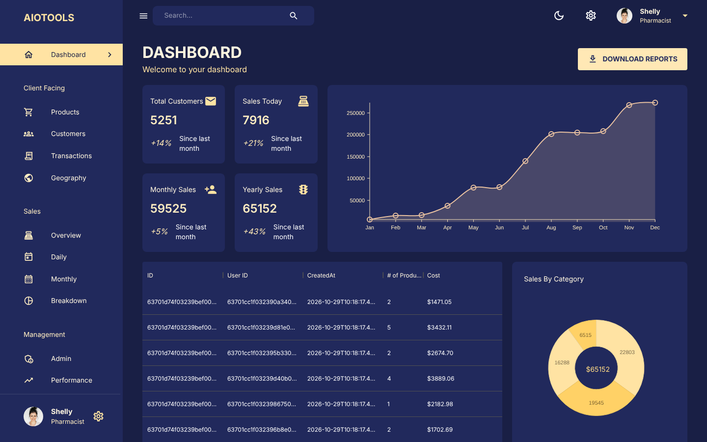
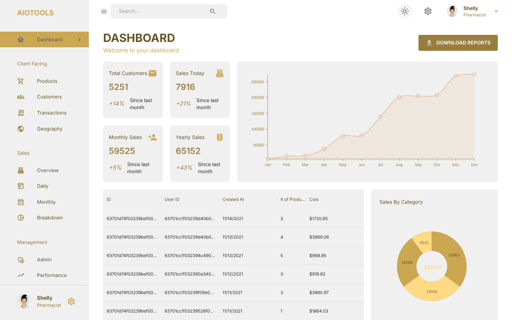
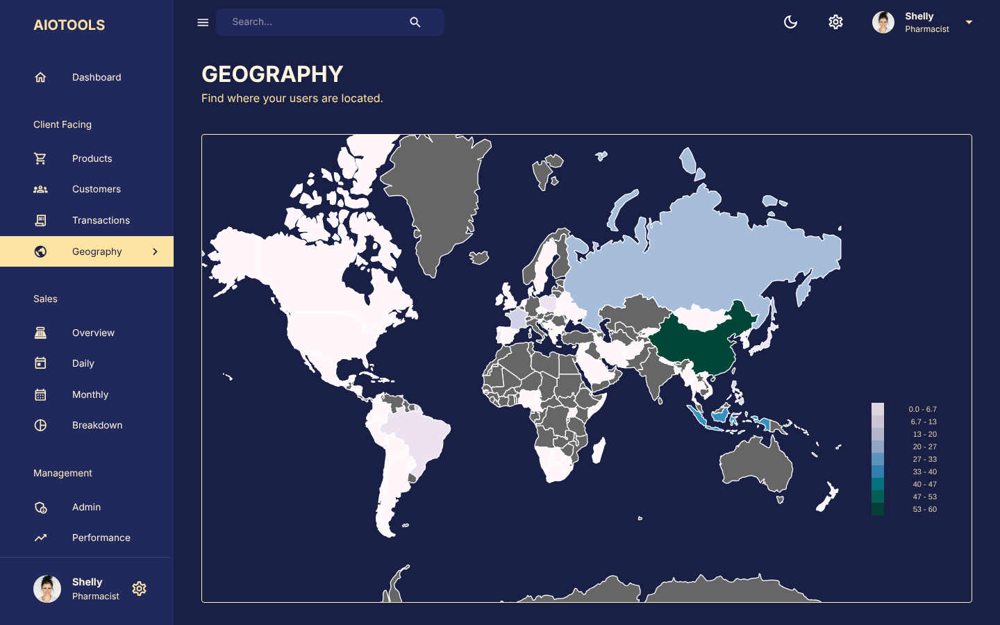

# AIOTOOLS DASHBOARD

A full stack admin dashboard (React, Material UI, Redux Toolkit, Node, Express, MongoDB) with sales charts, a world map of customers, paginated transactions and dark/light mode. It ships with sample data, so it works as a demo straight away.



| Light mode | Geography |
| --- | --- |
|  |  |

## Run the demo

### With Docker (easiest)

```bash
docker compose up --build
```

Open http://localhost:9000. This starts MongoDB and the app, and loads the sample data the first time it runs on an empty database. Set `PORT=8080` to use another port.

### Without Docker

You need Node 18+ and a MongoDB you can reach (local, Docker or Atlas).

```bash
# API (http://localhost:9000)
cd server
cp .env.example .env   # set MONGO_URL if it isn't a local MongoDB
npm install
npm run dev

# Client (http://localhost:3000), in another terminal
cd client
npm install
npm start
```

The client calls the API at `/api`, and in development requests are proxied to port 9000. To point it somewhere else, set `REACT_APP_BASE_URL` before building.

`npm run seed` in `server/` wipes the collections and reloads the sample data.

### Production build without Docker

Run `npm run build` in `client/`, then `npm start` in `server/`. The API serves the built client from `client/build`, so one process serves the whole app.

## Notes

The sample data covers 2021, so the dashboard's "today" and "this month" figures are fixed to November 2021. The signed-in user ("Shelly") is a fixed sample user; there is no login.

## Description :

This is the full stack admin dashboard project I created in my post graduation. This admin dashboard helps admins to manage their team and get the related info filtered and organized. The front end is built using React, material UI, and Redux-toolkit. The backend has been built using Node, Express, and MongoDB. Dark and light mode options has been made available.

## Front End :
## How It's Made:

Tech used: React JS, Material UI, Redux-toolkit

Material UI makes styling really easy for the react front end. Redux-toolkit makes state management easy. API calls are all made at one place using redux-toolkit query.

### Optimizations

There is abutton added for Settings page. That could be implemented with admin having the choice of adding new users.

### Lessons Learned

Using Material UI to style the front end was something new and interesting for me to learn.
Using Redux-toolkit to manage state and to make API calls in one place was a new experience for me.

## Back End :
## How It's Made:

Tech used: Node JS, Express JS, MongoDB.

### Optimizations

Api for adding new users could be added.

### Lessons Learned

Inserting user data and other sales related data in bulk was a new experience for me.
